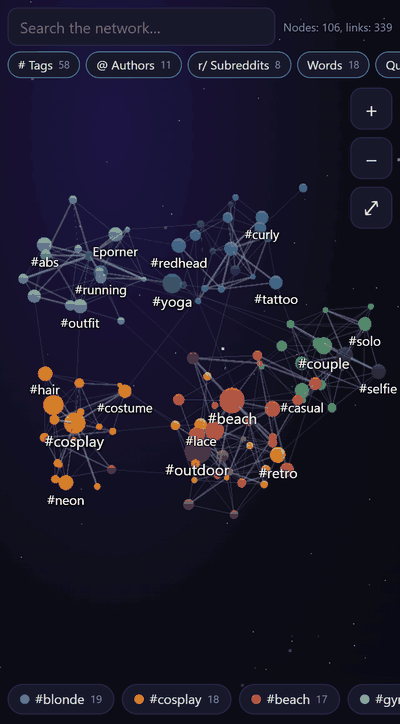
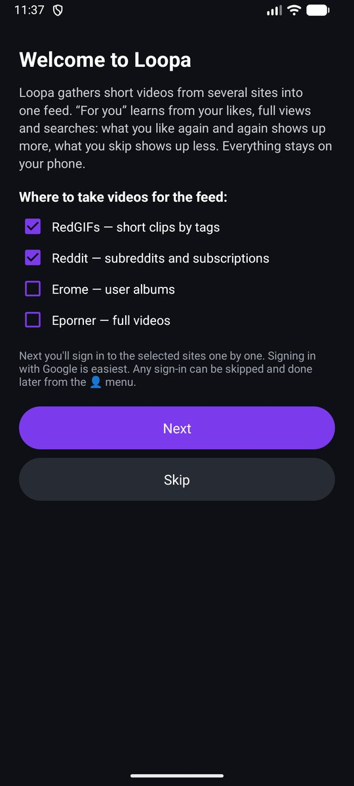
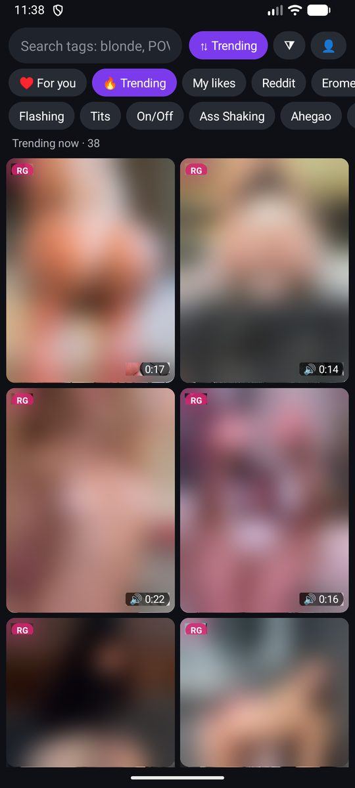
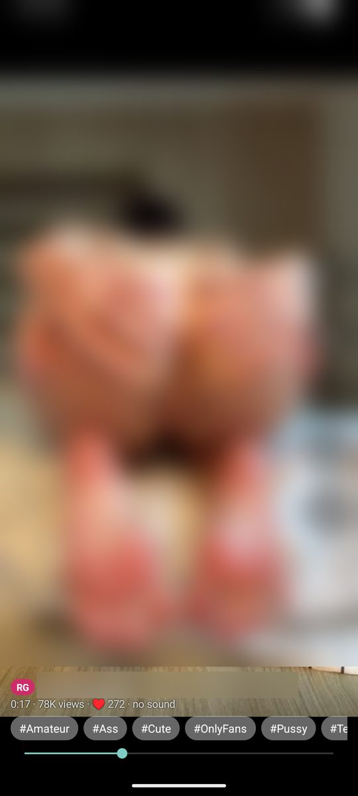

<p align="center">
  
</p>

<h1 align="center">Adult Space</h1>
<p align="center"><i>(formerly Loopa — same app, updates install over it)</i></p>

<p align="center">
  A free, lightweight open-source Android app for short videos from RedGIFs, Reddit, Erome, Eporner, xVideos, XNXX, Pornhub, RedTube, xHamster, FikFap, YouPorn, Tube8, TNAFlix, EMPFlix, YouJizz, PornOne and EroProfile in one ad-free
  feed: full-screen vertical swiping, fast playback, its own “For you”, search and downloads (Reddit videos with sound).
  <br><br>
  <a href="https://github.com/jainikdroid-bit/loopa/releases/latest"><b>Download APK</b></a> ·
  <a href="https://jainikdroid-bit.github.io/loopa/">Website</a> ·
  <a href="README.md">Русский</a>
</p>

<p align="center">
  
  <br><sub><i>3D interest graph: your taste as a starry sky</i></sub>
</p>

> [!WARNING]
> **Adults only (18+).** The app shows content from RedGIFs, Reddit, Erome, Eporner, xVideos, XNXX, Pornhub, RedTube, xHamster, FikFap, YouPorn, Tube8, TNAFlix, EMPFlix, YouJizz, PornOne and EroProfile, some of which is sexually explicit. Install it only if
> you are 18 or older and viewing such content is legal where you live.

> [!NOTE]
> **Space.** Adult Space is your own universe of short videos: interests look like stars, the links between them like constellations. The 3D graph shows your taste as a night sky.

> **Unofficial app.** Adult Space is not affiliated with or endorsed by RedGIFs, Reddit, Erome, Eporner, xVideos, XNXX, Pornhub, RedTube, xHamster or FikFap. Their names are
> trademarks of their owners.
> The app hosts and redistributes nothing: it only displays what the service already serves to any web browser.

<p align="center">
  
  
  
  <br><sub>Clips in the screenshots are blurred.</sub>
</p>

PeerTube supplies explicitly labelled adult videos from Sepia Search to search and For You. **MFC Share ↗** opens the free recordings catalog in your browser, or searches tagged albums when the search box contains text. Access is managed by MFC Share.

For You learns from comparisons between a positive interaction and a recent skip. Features that distinguish the two help rank new videos. Learning runs on the device.

Search learns preferences for each query on the device. With relevance sorting, choosing among matching videos influences future results for the same query. Literal phrases rank first, followed by matches containing every word. Learned combinations of tags, title words and creators help rank matches within each group.

## Features

- **Ad-free feed** — boosted and promoted videos are filtered out.
- **Live grid previews** — cut like big video sites do: snippets from the start, a third, two thirds and the end, on a
  loop, so you get the gist at once. Thumbnails load first, video fades in when ready. **RG** / **RD** badges show
  RedGIFs or Reddit. Fewer previews on slow networks; can be turned off in the settings.
- **Fast start and smart preloading.** The grid loads ahead what is about to appear: from the fling velocity it
  works out where the feed will stop, so thumbnails there (and one screen beyond) are already in memory when you get
  there, and the first seconds of those videos are in the disk cache; the next feed page is requested three screens
  before the end. In the player, the start of the next 1–2 videos in the swipe direction is preloaded (Media3
  PreloadManager), but only once the video on screen has buffer: while it is loading, preloading pauses. Depth depends
  on the network: fast — more, mobile — one video, Data Saver — nothing; fast swiping skips the clips in between.
- **Russian search:** a Russian query is translated to English with a built-in dictionary and searched on every source alongside the original; relevance takes the better of the two. Unknown Russian words are dropped.
- **Grid layout:** number of columns (portrait 1–4, landscape 2–6), tile ratio (1:1, 3:4, 9:16, 16:9) and spacing — ⧩ → “Settings” → “Feed”; defaults unchanged.
- **Four colour themes:** black (default), pink, red and violet — the background stays dark, the accent colour and the tint of surfaces change. Choose in ⧩ → “Settings” → “Appearance”; applied at once on every screen, including the player and the 3D graph.
- **Disk cache.** Videos — an LRU cache of 512 MB–1 GB depending on free space (or 512 MB / 1 GB / 2 GB in ⧩ → “Settings” → “Video
  cache”); the player, preloading and live previews all write to it, so rewatching plays from disk without network.
  Thumbnails — 128 MB on disk plus an in-memory LRU, decoded at cell size.
- **Built for long links** (VPN, satellite, ~800 ms ping, ~5 Mbit/s): one HTTP client (OkHttp) with a connection pool
  and HTTP/2, cached DNS and redirects, connections to video and image servers opened ahead of time; video streams in one
  request, playback starts after 1 s of buffer, 15–20 s timeouts without needless restarts; Auto quality starts in SD
  and switches to HD only when measured speed allows. A dead link shows “can't be opened” right away.
- **Full-screen vertical swiping**, seek bar, pause, sound toggle.
- **Auto quality** — HD on fast networks, SD on slow ones; or pin HD / SD.
- **Tag search** with suggestions and counts; text search when the query isn't made of tags.
- **Sorting** — relevance, trending, top of week / month / all time, newest, plus longest / shortest first, most
  liked, most viewed, rating (likes per view). Creator pages also offer “oldest first”.
- **Filters** — duration (under 15 s, 15–60 s, over a minute) and “with sound only”. Your choice is remembered.
- **Built for bad networks.** Drops and timeouts are retried automatically; the feed and the video resume as soon as
  the connection is back. On slow links Auto quality picks SD, and if HD stalls anyway it switches to SD from the same
  second; neighbour preloading backs off so the current video gets the bandwidth. Thumbnails on screen load first and
  are cached on disk.
- **Creator pages** and tag jumps straight from the player.
- **“Similar” in the player** (▦ button): a panel of videos similar in meaning — by specific tags, title words, creator
  and subreddit, from all enabled sources. Tap one and it is queued right after the current video.
- **Erome and Eporner.** Tabs for these sites with their own search and “newest” sorting; a video's creator and tags are
  searched on the same site. Optional sign-in on the site's own page in an embedded window; once signed in, “For you”
  also draws on your subscriptions and favourites there.
- **xVideos, XNXX, Pornhub, RedTube, xHamster and FikFap.** Each site gets a tab in the feed when it is enabled, with its
  own search. Their videos are mixed into “For you”, search and “Similar” by your interests. There is no sign-in for
  them. These sites sign their video links and the links expire quickly, so a video's address is only resolved when
  it is opened; a removed video shows “can't be opened” right away.
- **Welcome screen** on first launch: pick sources (including the new sites) and sign in to them one by one (every step can be skipped). Sources
  can be changed later via ⧩ → “Settings” → “Sources”.
- **Optional sign-in** — “For you” feed, likes, “My likes”. Sign-in is remembered and silently renewed in the
  background, so you don't have to log in again.
- **Reddit in the same client.** A Reddit tab with your subscriptions, any subreddits (several at once, space-separated)
  and user posts; hot, new, rising and top of hour / day / week / month / year / all time. Videos are taken from posts:
  Reddit-hosted videos (with sound), RedGIFs links, Imgur and GIFs. Sign-in happens on reddit.com in an embedded window,
  just like RedGIFs; 18+ content appears if it's enabled in your Reddit account settings.
- **Auto-update from GitHub.** On every launch (and every 6 hours) Adult Space checks the latest release, downloads the APK
  and verifies its SHA-256 against the release file; mode is manual / ask / automatic (⧩ → “Settings” → “Updates”).
- **Taste network and 3D interest graph** (⧩ menu → “Interest graph…”). Tags, creators, subreddits, words, searches and
  sites are nodes of one network linked by the clips you like; it grows as you use the app. In the 3D graph sphere size
  is weight and colour is community, with type filters, search, zoom and “Open in feed”. Open the graph with the round
  🕸️ button in the bottom-right corner of the tile screen. Node labels are tappable — a tap opens the node in the feed
  (for neighbours in the panel there is a “↗” icon). The “My weight” slider sets a node's own weight as a number (0 to 20 and
  more); it is pinned and never changes by itself, “Reset” brings the learned weight back; the graph shows every link between its nodes.
  Rendering adapts to the phone hardware: low-end phones draw less, the logic stays the same.
- **“For you” with its own algorithm.** An interest profile learns from likes, total watch time (including replays), skips,
  searches and downloads — by tags, words in titles and descriptions, subreddits and creators; old tastes fade on their
  own. Tags work as a small “taste network”: tags you like, download and search often weigh more, tags that keep
  showing up together get linked, and a tag never liked by itself but always next to your favourites gets weight
  from them; words of a search are linked to the tags of clips you like right after it, and skipping a clip the
  network expected you to like counts double. It picks RedGIFs videos and mixes in Reddit posts from matching subreddits (18+ included, which Reddit's own
  recommendations leave out), plus Erome, Eporner, xVideos, XNXX, Pornhub, RedTube, xHamster and FikFap if enabled. Each source's share is “low / medium / high”; the
  profile is shown in “My interests” and in the 3D interest graph (⧩ menu → “Interest graph…”: sphere size is the tag weight, a slider sets the weight of any node as a number) and stays on the phone. While interests are still few, the feed is topped up
  with popular videos so it never runs dry.
- **Hide topics:** gay content, sissy/femboy/trans (lesbian stays) and your own words. Duplicate videos and reuploads
  are removed from the feed.
- **Downloads** into `Downloads/Loopa` — player button or long-press in the grid: RedGIFs, Imgur, Erome, Eporner, xVideos, XNXX, Pornhub and RedTube
  via the system download manager (mp4); Reddit videos are fetched as separate video and audio tracks and muxed into one mp4
  without re-encoding. xHamster and FikFap videos (HLS only) can't be downloaded yet.
- Small, with no trackers, analytics or ad SDKs.

The interface is available in 10 languages (system language by default; change it via ⧩ → “Settings” → “Appearance”); tags on the service are in English. Translations live in `i18n/strings.json` — improvements welcome.

## Install

1. Get `AdultSpace-<version>.apk` from [Releases](https://github.com/jainikdroid-bit/loopa/releases/latest).
2. Open it on your phone and allow installs from that source.
3. Optionally verify it against `SHA256SUMS`.

Requires Android 8.0+.

> **Status (27 November 2026):** published release 1.38 is dated 26 November. Branch `prepare/stability-1.38` contains unreleased lifecycle, statistics consent and local technical counter changes. [Verification and limitations](docs/DEVELOPMENT_STATUS.md).

## Privacy

- The app primarily contacts external sources, plus update checks and the statistics endpoint described below. Examples include the RedGIFs API and video servers; Reddit (`oauth.reddit.com` /
  `www.reddit.com`, `v.redd.it`, `i.redd.it`, `preview.redd.it`, `i.imgur.com`); `www.erome.com` and its video servers;
  the open `www.eporner.com` API; the pages and video servers of xVideos, XNXX, Pornhub, RedTube, xHamster and FikFap. For “related tags” in search it queries the open Pornhub webmasters API
  (`www.pornhub.com/webmasters`, the query text only, nothing about you). The sign-in windows are the exception:
  they show the real sites with everything those sites load.
- Without sign-in it uses the temporary guest token the service hands to every website visitor.
- Release 1.38 enables statistics after notice. The Settings → About switch lets you turn them off. Development code for the next release requires explicit opt-in and preserves previous opt-outs. With consent, the server receives a pseudonymous install ID, app version, device model, Android version, language, network type, sessions, and aggregate counters. Counters describe feature use, first search-page outcomes, load errors, buffering after playback starts, automatic switches to SD, and time-to-first-frame ranges. The Cloudflare Worker gets country and region from connection metadata. The statistics database does not store IP addresses. Search text, tags, viewing history and media URLs are excluded from telemetry.
- Local technical diagnostics use a separate opt-in. They keep aggregate counts for up to 10,000 events in a fixed 30-day window. Export requires a manual action. Turning diagnostics off clears those local counters.
- Sign-in happens on the real site page (`redgifs.com`, `reddit.com`, `erome.com`, `eporner.com`) in an embedded window. You type your password into the site; the app
  never sees or stores it — only the session token or cookies are kept, in the app's private storage on your phone.
- Cloud backup of app data is disabled.
- The app identifies itself honestly (`User-Agent: Loopa/…`) instead of pretending to be a browser.

## Versions

The latest APK in [Releases](https://github.com/jainikdroid-bit/loopa/releases) is **1.38** (26 November 2026).

| Version | What's new |
|---|---|
| 1.10 | Instagram-style preloading: scroll forecast, thumbnails then video starts ahead, next page early; disk cache 512 MB–1 GB with a menu setting; OkHttp with connection reuse, tuned for ~800 ms ping |
| 1.10.1 | Slow networks (under 9 Mbit/s): 2 live previews instead of 8, on-screen thumbnails load first, background loads no longer delay the opened clip; tiles do not flicker; cache up to 5–10 GB (video) and 1 GB (thumbnails); ♥ badge on liked clips; For You uses like ratio and author/topic diversity; search considers your interests |
| 1.10.2 | The feed is not empty on launch: the previous one (For You, Trending) shows at once and fresh clips are appended; thumbnails are fetched 3–6 screens ahead, video after them; on slow networks up to 6 live previews when the clips are fully cached |
| 1.11 | Share a RedGIFs or Reddit link (post, redd.it, v.redd.it) to Loopa and it downloads the clip right away to Downloads/Loopa; likes you gave on Reddit earlier now count toward For You tastes (My interests → Import Reddit likes) |
| 1.11.1 | Share links from a Reddit user profile (`/u/name/s/code`, `/user/…`) are downloaded too |
| 1.11.2 | Sharing a RedGIFs page (search, user, tag) opens it in the Loopa feed |
| 1.12 | Auto-update from GitHub Releases (checked every 6 hours, downloaded, SHA-256 verified, installed on a tap; “Updates…” menu); paste a RedGIFs or Reddit clip link into search and Loopa downloads it |
| 1.12.1 | Update mode to choose: manual / ask (download and ask) / automatic (download and install); ⧩ menu → “Updates…” |
| 1.12.2 | “For you” taste network: tags frequent in your likes and searches weigh more, weight flows to tags that always sit next to your favourites; search words get linked to the tags of clips you liked after it; “Close to your favourites” in “My interests” |
| 1.13 | Six new sources: xVideos, XNXX, Pornhub, RedTube, xHamster, FikFap — checkboxes on the welcome screen and in 👤 → “Sources”, tabs in the feed, mixed into “For you”, search and “Similar”; downloads work for xVideos, XNXX, Pornhub, RedTube (xHamster and FikFap not yet) |
| 1.14 | 3D interest graph (⧩ menu → “Interest graph…”): tags are spheres sized by weight, links are what you like together, communities are coloured as in graphify; tag search, zoom with buttons and fingers; “My weight for this tag” slider ×0.1…×3 makes a tag show up more or less in “For you”; “Open in feed” |
| 1.15 | Taste network from all interests: tags, creators, subreddits, title words, searches and sites are nodes of one network; a liked clip links its tags with its creator, subreddit and site, a search links to the tags of clips liked after it; weight flows across types and “For you” scores clips by the whole network; the network grows with use (up to 1500 tags, 6000 links); the 3D graph shows up to 2000 nodes with type filters, a weight slider on any node and “Open in feed” for creators, subreddits, searches and sites |
| 1.16 | The 3D graph adapts to the hardware: memory, CPU cores and 64-bit support give the phone a level (low, mid, high); on low-end phones fewer nodes, links and labels are drawn with simpler spheres and lines, and if the frame rate drops below 24 fps the graph simplifies itself. The taste network logic, search and sliders stay the same on every phone |
| 1.17 | Updates are checked on every app launch (at most once per 10 minutes), not only every 6 hours: a new version is found right away |
| 1.17.1 | 3D graph: after picking a tag (by search or from neighbours) and changing its weight, the graph rotates around its own centre rather than that tag — the sphere no longer sticks to the middle of the screen |
| 1.18 | Site intros are skipped: first 3.4 s on Pornhub and RedTube, 5 s on xHamster (measured); live previews start after it and the player starts after it, you can seek back to it, downloads stay complete. Interests are counted by total watch time of a clip (including replays and returns), not by watching to the end, so long videos count too. Shorter “For you” header without the list of sources |
| 1.19 | The app is renamed Adult Space (formerly Loopa): new constellation icon, a starry background for the 3D graph (off on weak phones), a space-themed line on the welcome screen; fixed: live previews in the grid no longer freeze — background loads were limited to 5 requests per server, and a stuck preview now has a watchdog that restarts it |
| 1.20 | Menu and theme design: the ⧩ menu is short now (sorting, duration, sound, interest graph, “Settings…”); everything else moved to a Settings screen with sections: Feed, Sources, Interests, Video and cache, Accounts, Appearance, Updates, About; the 👤 menu keeps quick sign-in/sign-out. Four themes: black (as before), pink, red, violet — the accent colour and the tint of surfaces change on every screen, including the player and the 3D graph; applied at once |
| 1.21 | Interest graph: a round 🕸️ button on the tile screen; node labels are tappable (a tap opens the feed, neighbours in the panel have a “↗” icon); more links: the graph shows every link between its nodes, the network learns combinations from 12 tags per clip (generic tags are linked with specific ones too, but weaker), title words with 6 tags; the “My weight” slider now sets an absolute node weight (pinned, does not decay; “Reset” returns the learned one), old multipliers are converted automatically |
| 1.22 | All sources are on by default (including the welcome screen); for existing installs they are switched on once on update — turn any off in Settings → Sources |
| 1.23 | Stricter search with all sites mixed together: one score for every source, a single word must match as a whole word, several words must all match, synonym-only matches appear only while exact ones are few; the feed no longer jumps while loading: new items go only below what is already shown |
| 1.24 | Relevance search: exact matches first, then similar ones (synonyms, then root, inside-a-word and partial multi-word matches) instead of cutting the results short |
| 1.25 | Taste model — a factorization machine trained on the phone: it learns combinations of tags, creators, sites and words from watch time, likes, downloads, link taps and skipped clips, blended with the taste network. “Similar” keeps a step history: “back” returns to the clip you opened it from. Previews: software decoding beyond the hardware decoders, a frame-based watchdog; on slow networks all visible previews play — started one by one, each looping its own cached piece. A spinner in the status line while searching. The search box always searches every source, even on a site tab |
| 1.26 | Seven more sites: YouPorn, Tube8 (Pornhub network, 3.4 s intro skipped), TNAFlix, EMPFlix, YouJizz, PornOne and EroProfile (home videos) — on right away, in tabs, “For you”, search and “Similar” |
| 1.27 | Site age gates (“I am 18”, “Enter”) in sign-in windows and the hidden browser are passed automatically: “age verified” cookies are set in advance, the rest is clicked for you. A source that returns a captcha, an age gate or blocks access no longer vanishes silently: a yellow “!” badge appears on the feed and opens “Sources need attention” — open the site in the built-in browser, pass the check and tap “Done”; afterwards the app’s requests to that site carry the browser’s cookies and User-Agent. The “needs a check” mark is also shown in Settings → Sources. The player seek bar is wider and thicker (52 dp touch zone, a nearby tap no longer pauses the video) and shows what is already loaded: the player buffer and the scattered cached chunks. Fully cached watched videos are moved into plain files in “Downloads/AdultSpace/cached videos” (or your own folder) and play from there; they are removed from the cache, so there is one copy, not two. Streams (Reddit, xHamster, FikFap) are remuxed into mp4 without re-encoding when all segments are cached (otherwise they stay in the cache) The saved-videos folder gets a `.nomedia` file (the gallery hides them); saved videos and the video cache share one cache limit — beyond it the least recently watched item among all of them is deleted. A tag tapped in the player searches all sources. Grid previews are three pieces: from 10 %, 50 % and 80 % of the clip (studio titles at the start are skipped), on slow networks too. |
| 1.28 | Previews of Pornhub, YouPorn, RedTube and Tube8 clips show the three hottest moments from the site’s view statistics (peaks above neighbouring segments); other sites use pieces from 10/50/80 % |
| 1.29 | Preview hot moments — one in each part of the clip (start 5–30 %, middle 35–65 %, end 70–95 %); a part without a clear peak uses 10/50/80 %: pieces never bunch up, so the story shows |
| 1.30 | Settings → Sources → “Source check”: the status of every site (working / needs a check / temporary error, when it last answered) and a manual check, even without the “!” badge |
| 1.31 | “For you” remembers the last 240 tiles: one scrolled past 4 times drops lower; the player shows a cache bar and fills gaps; feed and search learn from skipped / watched / liked / downloaded, search puts the exact phrase first; new source PeerTube (explicitly tagged adult posts) |
| 1.9.2 | No more frozen start: the player page isn't rebound when the feed loads more, no stale frame on swipe, neighbours preload after the current video has buffer, dead links fail fast |
| 1.9.1 | “For you” never runs dry: topped up with popular videos when interest matches are few |
| 1.9 | Erome and Eporner, sign-in to them, “Similar” in the player, welcome screen, source shares “low / medium / high” |
| 1.7.1 | Back returns to the previous results, previews play while scrolling, “For you” by tag pairs; a broken video no longer skips ahead |
| 1.7 | Interface in 10 languages |
| 1.6–1.6.8 | Live relevance search, synonyms and abbreviations, tag relations, more Reddit |
| 1.5–1.5.1 | ↑↓ sorting, Reddit and related tags in search, previews in every visible cell |
| 1.4 | Reddit via the website, “Hide”, no duplicates |
| 1.3 | Cut-style live previews, RG / RD badges |
| 1.2 | “For you” with its own interest algorithm |
| 1.1 | Reddit in the same client, Reddit downloads with sound |
| 1.0 | First release: ad-free RedGIFs |

## Build

```bash
git clone https://github.com/jainikdroid-bit/loopa.git
cd loopa
./gradlew assembleRelease
```

Requires JDK 17 and Android SDK 35. Unit tests (scroll forecast, preload depth, cache size): `./gradlew testReleaseUnitTest`. Without `keystore.properties`, release builds remain unsigned; `-PallowDebugReleaseSigning=true` is for local testing only. APKs in Releases are signed with the project key; certificate SHA-256 fingerprint:

```
32:9D:15:73:05:60:8C:5D:F2:1B:D7:7B:ED:3F:9C:70:DC:1C:38:D0:F9:44:A6:F8:C9:69:26:12:90:44:9C:84
```

## Be gentle with the service

Adult Space uses the same API as the website and behaves like a regular viewer: the guest token is fetched once and reused for
up to 12 hours, videos load only as you watch, there is no bulk downloading. Please don't turn it into a scraper.

## Rights holders

The app does not host videos or bypass access restrictions. If you represent one of these services or are a rights holder and have concerns about this
project, please open an [issue](https://github.com/jainikdroid-bit/loopa/issues).

## License

[MIT](LICENSE). Uses AndroidX and Media3 (Apache 2.0). API paths learned from the open-source wrapper
[scrazzz/redgifs](https://github.com/scrazzz/redgifs).
