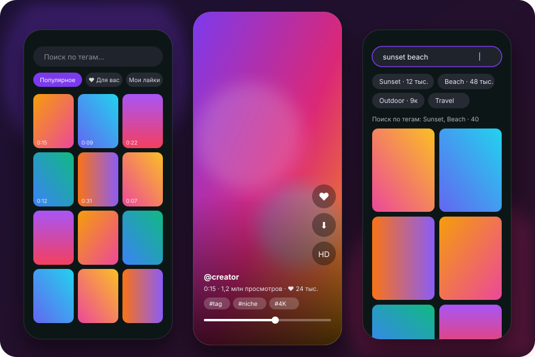

<p align="center">
  
</p>

<h1 align="center">Loopa</h1>

<p align="center">
  A free, lightweight open-source Android app for short videos from RedGIFs, Reddit, Erome and Eporner in one ad-free
  feed: full-screen vertical swiping, fast playback, its own “For you”, search and downloads (Reddit videos with sound).
  <br><br>
  <a href="https://github.com/jainikdroid-bit/loopa/releases/latest"><b>Download APK</b></a> ·
  <a href="https://jainikdroid-bit.github.io/loopa/">Website</a> ·
  <a href="README.md">Русский</a>
</p>

> [!WARNING]
> **Adults only (18+).** The app shows content from RedGIFs, Reddit, Erome and Eporner, some of which is sexually explicit. Install it only if
> you are 18 or older and viewing such content is legal where you live.

> [!NOTE]
> **Unofficial app.** Loopa is not affiliated with or endorsed by RedGIFs, Reddit, Erome or Eporner. Their names are
> trademarks of their owners.
> The app hosts and redistributes nothing: it only displays what the service already serves to any web browser.

<p align="center">
  
</p>

## Features

- **Ad-free feed** — boosted and promoted videos are filtered out.
- **Live grid previews** — cut like big video sites do: snippets from the start, a third, two thirds and the end, on a
  loop, so you get the gist at once. Thumbnails load first, video fades in when ready. **RG** / **RD** badges show
  RedGIFs or Reddit. Fewer previews on slow networks; can be turned off in the menu.
- **Fast start and smart preloading.** The grid loads ahead what is about to appear: from the fling velocity it
  works out where the feed will stop, so thumbnails there (and one screen beyond) are already in memory when you get
  there, and the first seconds of those videos are in the disk cache; the next feed page is requested three screens
  before the end. In the player, the start of the next 1–2 videos in the swipe direction is preloaded (Media3
  PreloadManager), but only once the video on screen has buffer: while it is loading, preloading pauses. Depth depends
  on the network: fast — more, mobile — one video, Data Saver — nothing; fast swiping skips the clips in between.
- **Disk cache.** Videos — an LRU cache of 512 MB–1 GB depending on free space (or 512 MB / 1 GB / 2 GB in ⧩ → “Video
  cache”); the player, preloading and live previews all write to it, so rewatching plays from disk without network.
  Thumbnails — 128 MB on disk plus an in-memory LRU, decoded at cell size.
- **Built for long links** (VPN, satellite, ~800 ms ping, ~5 Mbit/s): one HTTP client (OkHttp) with a connection pool
  and HTTP/2, cached DNS and redirects, connections to video and image servers opened ahead of time; video streams in one
  request, playback starts after 1 s of buffer, 15–20 s timeouts without needless restarts; Auto quality starts in SD
  and switches to HD only when measured speed allows. A dead link shows “can't be opened” right away.
- **Full-screen vertical swiping**, seek bar, pause, sound toggle.
- **Auto quality** — HD on fast networks, SD on slow ones; or pin HD / SD.
- **Tag search** with suggestions and counts; text search when the query isn't made of tags.
- **Sorting** — relevance, trending, top of week / month / all time, newest, plus longest / shortest first, most
  liked, most viewed, rating (likes per view). Creator pages also offer “oldest first”.
- **Filters** — duration (under 15 s, 15–60 s, over a minute) and “with sound only”. Your choice is remembered.
- **Built for bad networks.** Drops and timeouts are retried automatically; the feed and the video resume as soon as
  the connection is back. On slow links Auto quality picks SD, and if HD stalls anyway it switches to SD from the same
  second; neighbour preloading backs off so the current video gets the bandwidth. Thumbnails on screen load first and
  are cached on disk.
- **Creator pages** and tag jumps straight from the player.
- **“Similar” in the player** (▦ button): a panel of videos similar in meaning — by specific tags, title words, creator
  and subreddit, from all enabled sources. Tap one and it is queued right after the current video.
- **Erome and Eporner.** Tabs for these sites with their own search and “newest” sorting; a video's creator and tags are
  searched on the same site. Optional sign-in on the site's own page in an embedded window; once signed in, “For you”
  also draws on your subscriptions and favourites there.
- **Welcome screen** on first launch: pick sources and sign in to them one by one (every step can be skipped). Sources
  can be changed later via 👤 → “Sources: For you and search”.
- **Optional sign-in** — “For you” feed, likes, “My likes”. Sign-in is remembered and silently renewed in the
  background, so you don't have to log in again.
- **Reddit in the same client.** A Reddit tab with your subscriptions, any subreddits (several at once, space-separated)
  and user posts; hot, new, rising and top of hour / day / week / month / year / all time. Videos are taken from posts:
  Reddit-hosted videos (with sound), RedGIFs links, Imgur and GIFs. Sign-in happens on reddit.com in an embedded window,
  just like RedGIFs; 18+ content appears if it's enabled in your Reddit account settings.
- **“For you” with its own algorithm.** An interest profile learns from likes, full watches and rewatches, skips,
  searches and downloads — by tags, words in titles and descriptions, subreddits and creators; old tastes fade on their
  own. It picks RedGIFs videos and mixes in Reddit posts from matching subreddits (18+ included, which Reddit's own
  recommendations leave out), plus Erome and Eporner if enabled. Each source's share is “low / medium / high”; the
  profile is shown in “My interests” and stays on the phone. While interests are still few, the feed is topped up
  with popular videos so it never runs dry.
- **Hide topics:** gay content, sissy/femboy/trans (lesbian stays) and your own words. Duplicate videos and reuploads
  are removed from the feed.
- **Downloads** into `Downloads/Loopa` — player button or long-press in the grid: RedGIFs, Imgur, Erome and Eporner via
  the system download manager; Reddit videos are fetched as separate video and audio tracks and muxed into one mp4
  without re-encoding.
- Small, with no trackers, analytics or ad SDKs.

The interface is available in 10 languages (system language by default; change it via 👤 → “Language”); tags on the service are in English. Translations live in `i18n/strings.json` — improvements welcome.

## Install

1. Get `Loopa-<version>.apk` from [Releases](https://github.com/jainikdroid-bit/loopa/releases/latest).
2. Open it on your phone and allow installs from that source.
3. Optionally verify it against `SHA256SUMS`.

Requires Android 8.0+.

## Privacy

- The app talks only to the sources themselves: the RedGIFs API and video servers; Reddit (`oauth.reddit.com` /
  `www.reddit.com`, `v.redd.it`, `i.redd.it`, `preview.redd.it`, `i.imgur.com`); `www.erome.com` and its video servers;
  the open `www.eporner.com` API. For “related tags” in search it queries the open Pornhub webmasters API
  (`www.pornhub.com/webmasters`, the query text only, nothing about you). The sign-in windows are the exception:
  they show the real sites with everything those sites load.
- Without sign-in it uses the temporary guest token the service hands to every website visitor.
- Sign-in happens on the real site page (`redgifs.com`, `reddit.com`, `erome.com`, `eporner.com`) in an embedded window. You type your password into the site; the app
  never sees or stores it — only the session token or cookies are kept, in the app's private storage on your phone.
- Cloud backup of app data is disabled.
- The app identifies itself honestly (`User-Agent: Loopa/…`) instead of pretending to be a browser.

## Versions

The latest APK in [Releases](https://github.com/jainikdroid-bit/loopa/releases) is **1.10.2**.

| Version | What's new |
|---|---|
| 1.10 | Instagram-style preloading: scroll forecast, thumbnails then video starts ahead, next page early; disk cache 512 MB–1 GB with a menu setting; OkHttp with connection reuse, tuned for ~800 ms ping |
| 1.10.1 | Slow networks (under 9 Mbit/s): 2 live previews instead of 8, on-screen thumbnails load first, background loads no longer delay the opened clip; tiles do not flicker; cache up to 5–10 GB (video) and 1 GB (thumbnails); ♥ badge on liked clips; For You uses like ratio and author/topic diversity; search considers your interests |
| 1.10.2 | The feed is not empty on launch: the previous one (For You, Trending) shows at once and fresh clips are appended; thumbnails are fetched 3–6 screens ahead, video after them; on slow networks up to 6 live previews when the clips are fully cached |
| 1.11 | Share a RedGIFs or Reddit link (post, redd.it, v.redd.it) to Loopa and it downloads the clip right away to Downloads/Loopa; likes you gave on Reddit earlier now count toward For You tastes (My interests → Import Reddit likes) |
| 1.9.2 | No more frozen start: the player page isn't rebound when the feed loads more, no stale frame on swipe, neighbours preload after the current video has buffer, dead links fail fast |
| 1.9.1 | “For you” never runs dry: topped up with popular videos when interest matches are few |
| 1.9 | Erome and Eporner, sign-in to them, “Similar” in the player, welcome screen, source shares “low / medium / high” |
| 1.7.1 | Back returns to the previous results, previews play while scrolling, “For you” by tag pairs; a broken video no longer skips ahead |
| 1.7 | Interface in 10 languages |
| 1.6–1.6.8 | Live relevance search, synonyms and abbreviations, tag relations, more Reddit |
| 1.5–1.5.1 | ↑↓ sorting, Reddit and related tags in search, previews in every visible cell |
| 1.4 | Reddit via the website, “Hide”, no duplicates |
| 1.3 | Cut-style live previews, RG / RD badges |
| 1.2 | “For you” with its own interest algorithm |
| 1.1 | Reddit in the same client, Reddit downloads with sound |
| 1.0 | First release: ad-free RedGIFs |

## Build

```bash
git clone https://github.com/jainikdroid-bit/loopa.git
cd loopa
./gradlew assembleRelease
```

Requires JDK 17 and Android SDK 35. Unit tests (scroll forecast, preload depth, cache size): `./gradlew testReleaseUnitTest`. Without `keystore.properties` the release build is signed with the debug key, which
is fine for personal use. APKs in Releases are signed with the project key; certificate SHA-256 fingerprint:

```
32:9D:15:73:05:60:8C:5D:F2:1B:D7:7B:ED:3F:9C:70:DC:1C:38:D0:F9:44:A6:F8:C9:69:26:12:90:44:9C:84
```

## Be gentle with the service

Loopa uses the same API as the website and behaves like a regular viewer: the guest token is fetched once and reused for
up to 12 hours, videos load only as you watch, there is no bulk downloading. Please don't turn it into a scraper.

## Rights holders

The app does not host videos or bypass access restrictions. If you represent one of these services or are a rights holder and have concerns about this
project, please open an [issue](https://github.com/jainikdroid-bit/loopa/issues).

## License

[MIT](LICENSE). Uses AndroidX and Media3 (Apache 2.0). API paths learned from the open-source wrapper
[scrazzz/redgifs](https://github.com/scrazzz/redgifs).
