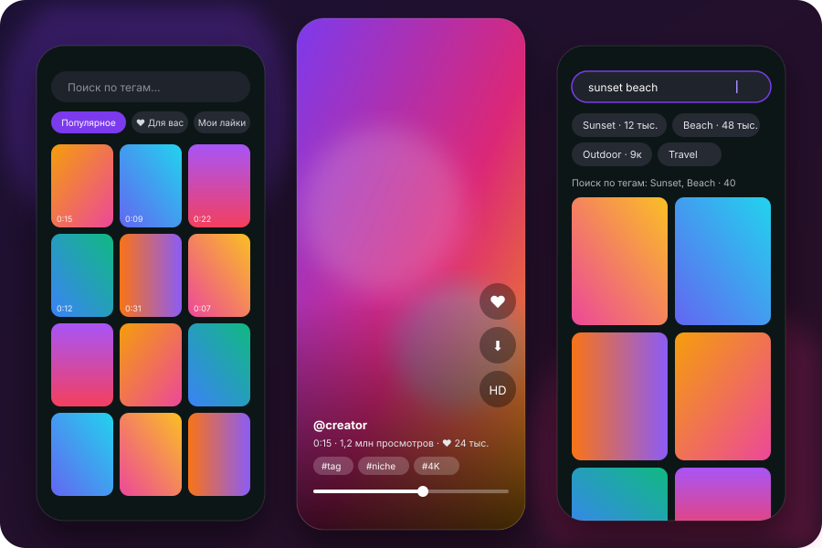

<p align="center">
  
</p>

<h1 align="center">Loopa</h1>

<p align="center">
  Лёгкий открытый Android-просмотрщик коротких роликов RedGIFs: лента без рекламы, плавная вертикальная прокрутка
  и мгновенный старт видео.
  <br><br>
  <a href="https://github.com/jainikdroid-bit/loopa/releases/latest"><b>Скачать APK</b></a> ·
  <a href="https://jainikdroid-bit.github.io/loopa/">Сайт</a> ·
  <a href="README.en.md">English</a>
</p>

<p align="center">
  
  
  
</p>

> [!WARNING]
> **Только для взрослых (18+).** Приложение показывает материалы сервиса RedGIFs, среди которых есть откровенные.
> Устанавливайте его, только если вам есть 18 лет и такие материалы законны там, где вы находитесь.

> [!NOTE]
> **Неофициальное приложение.** Loopa не связана с RedGIFs и не одобрена ими. RedGIFs — товарный знак его владельцев.
> Приложение ничего не хранит и не распространяет: оно лишь показывает то, что сервис сам отдаёт в браузер.

<p align="center">
  
</p>

## Возможности

- **Лента без рекламы.** Рекламные и продвигаемые ролики отфильтровываются.
- **Мгновенный старт.** Соседние ролики подгружаются заранее (Media3 PreloadManager), воспроизведение начинается через
  полсекунды буфера, просмотренное берётся из кэша.
- **Вертикальная прокрутка** на весь экран, как в коротких видео; перемотка, пауза, звук.
- **Качество «Авто»:** HD на быстрой сети, SD на медленной. Можно закрепить HD или SD.
- **Поиск по тегам** с подсказками и числом роликов; поиск по тексту, если запрос не складывается в теги.
- **Сортировка:** по релевантности, популярное, лучшее за неделю / месяц / всё время, новые, а также длинные или
  короткие сначала, больше лайков, больше просмотров, рейтинг (лайки к просмотрам). У автора — ещё «сначала старые».
- **Фильтры:** длительность (до 15 с, 15–60 с, дольше минуты) и «только со звуком». Выбор запоминается.
- **Плохая сеть — не помеха.** Обрывы и таймауты повторяются сами, лента и видео продолжают, как только вернулась
  связь. На медленном канале «Авто» включает SD, а если HD всё же подвис — переходит на SD с той же секунды;
  предзагрузка соседних роликов становится скромнее, чтобы не отнимать канал у текущего. Превью грузятся в первую
  очередь для того, что на экране, и кэшируются на диске.
- **Ролики автора** и переход по тегу прямо из плеера.
- **Вход в свой аккаунт (по желанию):** лента «Для вас», лайки, «Мои лайки». Вход запоминается и продлевается
  сам в фоне — заново входить не нужно.
- **Скачивание** через системный менеджер загрузок в «Загрузки/Loopa».
- Маленький размер, никаких трекеров, аналитики и рекламных SDK.

## Установка

1. Скачайте `Loopa-<версия>.apk` со страницы [Releases](https://github.com/jainikdroid-bit/loopa/releases/latest).
2. Откройте файл на телефоне и разрешите установку из этого источника.
3. Сверьте контрольную сумму из `SHA256SUMS`, если хотите убедиться, что файл не подменён.

Нужен Android 8.0 или новее. Интерфейс пока на русском; теги на сервисе — английские.

## Конфиденциальность

- Приложение обращается только к `api.redgifs.com` и серверам видео RedGIFs. Исключение — окно входа: там открывается
  сам сайт `redgifs.com` со всем, что он подгружает.
- Без входа используется временный гостевой токен, который сервис выдаёт любому посетителю сайта.
- Вход выполняется на настоящей странице `redgifs.com` во встроенном окне. Пароль вводится на сайте, приложение его
  не видит и не хранит; сохраняется только токен сессии — на телефоне, в личных данных приложения.
- Резервное копирование данных приложения в облако отключено.
- Приложение представляется сервису честно (`User-Agent: Loopa/…`), без маскировки под браузер.

## Сборка

```bash
git clone https://github.com/jainikdroid-bit/loopa.git
cd loopa
./gradlew assembleRelease
```

Нужны JDK 17 и Android SDK 35. Без `keystore.properties` релиз подписывается отладочным ключом — этого достаточно,
чтобы поставить сборку себе. Готовые APK в Releases подписаны ключом проекта; отпечаток SHA-256 сертификата:

```
32:9D:15:73:05:60:8C:5D:F2:1B:D7:7B:ED:3F:9C:70:DC:1C:38:D0:F9:44:A6:F8:C9:69:26:12:90:44:9C:84
```

## Бережно к сервису

Loopa ходит в тот же API, что и сайт, и ведёт себя как обычный зритель: гостевой токен берётся один раз и живёт до 12
часов, ролики грузятся только по мере просмотра, массового скачивания нет. Пожалуйста, не превращайте приложение в
скрейпер.

## Правообладателям

Приложение не размещает ролики и не обходит ограничения доступа. Если вы представляете RedGIFs и у вас есть претензии к
проекту, откройте [issue](https://github.com/jainikdroid-bit/loopa/issues) — вопрос будет рассмотрен.

## Лицензия

[MIT](LICENSE). Использованы библиотеки AndroidX и Media3 (Apache 2.0). Пути API подсмотрены в открытой обёртке
[scrazzz/redgifs](https://github.com/scrazzz/redgifs).
